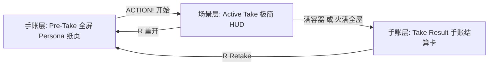

# 07 — UI / UX SPEC：界面风格、交互状态与视觉组件规范

> 本文定义《Persona》全部玩家可见 UI 的**风格方向、版式结构、交互状态、动效原则与验收条件**（玩家可见 UI 不采用直白贴靠 Game Jam 主题 `Director's Cut` 的电影片场道具）。
> 角色与场景画风见 [`06_ART_DIRECTION.md`](06_ART_DIRECTION.md)；规则与状态机见 [`01_GDD_CORE.md`](01_GDD_CORE.md)、[`03_ARCHITECTURE.md`](03_ARCHITECTURE.md)。
> **[技术必需]** UI 只订阅权威游戏状态做表现，**不得**自行维护或裁决 Persona 状态、交互许可、星数（见 `03_ARCHITECTURE.md` §6）。

---

## 1. 风格定位：「古早萌系手账」 `[已确认]`

**一句话**：角色怎么画，UI 就怎么画——纯色平涂、手绘马克笔线、大圆角；以日常手账纸页、纯色胶带贴角、荧光笔标注与马克笔涂改承载 Persona 编辑与结果复盘，不使用直白贴靠 `Director's Cut` 的电影片场道具。

| 设计原则 | 说明 |
|---|---|
| 与角色同一种绘画语言 | UI 描边统一采用与角色五官相同的**略带手绘抖动的暖墨黑马克笔线**；填色只用纯色块，不用渐变/高光/投影 |
| 界面叙事 | 演出外是「手账层」（奶油手账纸页、纯色胶带角、马克笔涂改、手账结算卡），演出中是「场景层」（无常驻面板、极简沉浸） |
| 冷幽默反差 | 危机信息也保持软萌憨拙表达（例：失去星容器 = 星星「烧焦冒烟」而非红色警报） |
| 火场可读性 | 火场主色为橙红，UI 主色避开橙红，以**奶油白 + 暖墨黑**为主，保证叠在火光上依然清晰 |

**严禁**：渐变、玻璃拟态/毛玻璃、写实投影、霓虹发光、赛璐璐硬阴影、厚重美漫黑描边、科幻 HUD 线框；同时严禁直白贴靠电影拍摄主题的视觉与文字元素——包括黑白斜纹场记板（Clapperboard）造型与打板合拍动效、`DIRECTOR'S CUT` 印章、好莱坞电影剧本（Screenplay）格式与打字机等宽字体、右上角常驻场记牌、页眉/结算卡上的 `SCENE XX` 场次号与 `TAKE XX` 递增计数、以及结算标题 `CUT!` 口令。

---

## 2. 视觉基础（Tokens）

### 2.1 色板 `[建议：待视觉稿校准后确认]`

| Token | 色值 | 用途 |
|---|---|---|
| `Paper` 奶油白 | `#FFF6E6` | 手账纸页、手账结算卡、思想泡泡底色 |
| `Ink` 暖墨黑 | `#2B2724` | 所有描边、正文、马克笔划除线 |
| `Peach` 桃橙 | `#F2A46F` | 思想泡泡描边、强调边框（来源 `example_4.png` 气泡） |
| `Blush` 腮红粉 | `#F4A9A0` | 可删块悬停态、按钮按下态、萌系点缀 |
| `Sky` 天空蓝 | `#9ED4EE` | 灭火读条（水）、安全区提示、固定块标识（来源皮埃尔徽章） |
| `Butter` 奶油黄 | `#FFD75E` | 点亮的实心星（外包 `Ink` 描边以区别火焰） |
| `Char` 炭灰 | `#6B625C` | 焦黑碎裂的星容器、禁用态 |
| `Highlighter` 荧光底 | `#FFE9A8` | 可删文字块下方的荧光笔底色 |

### 2.2 线条与形状 `[已确认]`
- 描边：`Ink` 色，手绘抖动感马克笔线；主面板约 3–4 px（1080p 基准），小图标约 2 px。
- 圆角：面板与按钮使用大圆角（约 16–24 px），整体软糯。
- 图标：几何简化 + 马克笔描边 + 纯色填充，与角色道具同一画法。
- 图标与 UI 中**允许出现英文**（UI 不参与镜像翻转）；世界内纸片仍遵守「禁字母数字」规则。

### 2.3 字体 `[待决定]`
- **Persona 正文与 UI 文本**：圆润手写感无衬线体或干净易读的手账风格字体（取消好莱坞电影剧本 Screenplay 版式与等宽打字机字体要求）。
- **按钮 / 提示 / 思想泡泡**：与正文协调的圆润手写感无衬线体。
- **硬约束** `[技术必需]`：必须为**可免费商用、可随 Windows 包分发**的开源授权字体（如 OFL）；具体字体由设计侧后续选定。

### 2.4 动效原则 `[已确认]`
- 节奏：多罗猫式「蹦跶」感——出现时短促回弹（overshoot），单段动效约 `0.3–0.5s`。
- 消失：快速缩小/淡出，不拖泥带水。
- 禁止：慢速漂浮、长时间发光呼吸、镜头震屏过度。
- 所有动效时长为表现参数，开放编辑器配置，不进入规则层。

---

## 3. 界面分层

| 层 | 阶段 | 视觉基调 |
|---|---|---|
| 手账层 | `Pre-Take`、`Take Result` | 奶油手账纸页、纯色胶带角、马克笔涂改笔迹与手账结算卡；全屏/居中卡片，鼠标操作 |
| 场景层 | `Active Take` | 极简沉浸，无大块状态面板或场记牌；仅右上角低打扰显示纯圆角键帽提示 `[R] Retake`，配合世界投影提示与短暂闪现反馈；键盘操作 |

---

## 4. 手账层：Pre-Take 全屏 Persona 纸页 `[已确认]`

### 4.1 版式
- 全屏一张奶油色手账纸页（可略带纸张边缘与纯色胶带贴角，纯色表现，无纹理噪点）。
- **页眉标题**：简洁展示角色或页面标题（如 `PERSONA` 或简短标题，具体英文由编辑器配置）；**取消** `SCENE 01` 场次号、`TAKE 01/02/03` 拍片递增计数及 `DIRECTOR'S CUT` 印章。
- **正文**：角色 Persona 以自然日常手账/独白段落连贯排布，各文字块按设计配置顺序排列（**取消**好莱坞电影剧本居中角色名与括号舞台指示版式）。
- **页脚**：大圆角纯色手账按钮（暖墨黑描边，示例文案 `ACTION!`，具体英文由编辑器配置；**取消**黑白斜纹场记板造型）。

### 4.2 文字块三态

| 状态 | 视觉 | 交互 |
|---|---|---|
| 固定块（不可删） | 普通 `Ink` 印刷体 | 无悬停反馈，光标保持默认 |
| 可删块（未删） | 文字下方 `Highlighter` 荧光底 + 细虚线下划线 | 悬停：底色转 `Blush`、光标变**剪刀**、轻微上浮；点击即删 |
| 已删块 | 整块被一道粗 `Ink` 马克笔线**划除，保留原文痕迹**（手账涂改感） | 不可再点击；本轮内不可单独恢复（见 `AGENTS.md` 红线 12） |

- 删除瞬间：马克笔从左到右「唰」地划过（约 `0.3s`）+ 轻微纸面抖动。
- 页面不提供单块撤销按钮；重置只能通过 `Restart Take`。

### 4.3 开始行动
- 点击底部 `ACTION!` 按钮：圆角按钮短促回弹按下 → 手账纸页向上收起/翻走 → 进入 `Active Take`，Persona 编辑锁定（不使用场记板打板合拍动效）。

---

## 5. 场景层：Active Take 极简 HUD `[已确认]`

### 5.1 低打扰重开提示（唯一常驻角标，无片场场记牌）
- **右上角低打扰纯键帽提示 `[R] Retake`（`WBP_RetakeHint`）**：采用与 `[E]` 键帽同语言的小尺寸圆胖键帽图标 `[R]`（`Paper` 底 + `Ink` 手绘描边）搭配简短 `Retake` 文字，适度控制尺寸与不透明度以保持低打扰；**严禁采用场记牌造型、黑白斜纹或 `TAKE XX` 计数显示**。
- 玩家可在 `Active Take` 任意时刻按键盘 `R` 键触发 `Restart Take` 完整重置并退回 `Pre-Take`。

### 5.2 世界投影提示
| 组件 | 规范 |
|---|---|
| **思想泡泡** | `Paper` 底 + `Peach` 粗描边 + 大圆角；**尾巴为一串由大到小的小圆点**（漫画「想法」气泡），与说话气泡区分；锚定角色头顶 3D 坐标、屏幕空间显示（见 `02_SPATIAL_MATH.md` §2.3）；弹出带回弹，数秒后缩小消失 |
| **`[E]` 交互提示** | 圆胖键帽图标（`Paper` 底 + `Ink` 描边 + 字母 E），出现在可交互目标上方，轻微上下弹跳 |
| **按住 `E` 灭火读条** | 沿键帽外圈的环形进度，以 `Sky` 水蓝色填充（语义=喷水）；UI 仅映射权威层的当前目标读条进度（如第一关单处火点松手中断时按火点保留已喷进度、不直接清空；保留进度是否随时间缓慢回退或随火势升阶增加所需量，见 [`08_LEVEL_01_FIREFIGHTER.md`](08_LEVEL_01_FIREFIGHTER.md) §12 `[待决定]`） |

### 5.3 非常驻星容器闪现
- **位置**：屏幕顶部居中；事件触发时弹出，约 `2s` 后淡出；不常驻。
- **三种视觉态**：

| 态 | 视觉 |
|---|---|
| 空心容器 | `Paper` 填充 + `Ink` 马克笔描边的圆胖五角星 |
| 点亮实心星 | `Butter` 填充 + `Ink` 描边；弹跳放大 + 几颗小闪点 |
| 容器扣减 | 最右侧空心星变 `Char` 焦黑 → 裂开 → 冒一小股卡通烟 → 消失；容器数 `3→2` 或 `2→1`。语气搞笑而非恐怖 |

### 5.4 待决定
- **[待决定]** 演出中是否允许按 `Tab` 只读查看当前 Persona（不可剪辑；同步收录于 [`08_LEVEL_01_FIREFIGHTER.md`](08_LEVEL_01_FIREFIGHTER.md) §12 与 [`04_DATA_SCHEMA.md`](04_DATA_SCHEMA.md) §4）。

---

## 6. 手账层：Take Result 手账结算卡 `[已确认]`

- 满足单轮结束条件后弹出大圆角奶油色**手账结算卡**（纯色平涂 + 暖墨黑手绘描边，可带纯色胶带贴角；**取消**场记板落下合拍动效、小黑板外框、`CUT!` 标题口令与 `TAKE XX` 计数行），展示：
  - 最终点亮星数 + 剩余容器；
  - 因局内目标降级或失效（例如第一关受困者受伤/遇难）而失去的容器，以**焦黑碎裂残影**保留在原位，帮助玩家复盘「差在哪里」；
  - 简短客观结果行（如第一关为火点状态 / 受困者状态，见 [`08_LEVEL_01_FIREFIGHTER.md`](08_LEVEL_01_FIREFIGHTER.md) §10.3），具体英文留空配置。
- 按钮：`[R] Retake`（回到 `Pre-Take`）。

---

## 7. 文案结构（英文，仅定结构，具体词句编辑器配置） `[已确认]`

| 槽位 | 结构要求 |
|---|---|
| 页眉标题 | 角色/页面简短标题（不含 `SCENE` 场次与 `TAKE` 计数） |
| 开始按钮 | 简短开始行动按钮文案（示例：`ACTION!`） |
| 思想泡泡 | 表层抗拒想法 + 隐晦指向过去经历的线索（见 `01_GDD_CORE.md` §3） |
| 交互提示 | 按键 + 动词 |
| 结算结果行 | 客观事实陈述，不评判玩家 |
| 重开按钮 | 按键 + 重开文案（示例：`[R] Retake`） |

---

## 8. 交付组件清单（与 [`08_LEVEL_01_FIREFIGHTER.md`](08_LEVEL_01_FIREFIGHTER.md) §10.3 对齐）

命名遵循 `05_ASSET_PIPELINE.md`：

| 组件 | 建议资产名 |
|---|---|
| Pre-Take 全屏 Persona 纸页 | `WBP_PreTakeScript` |
| 文字块（三态） | `WBP_PersonaBlock` |
| 开始行动圆角按钮 | `WBP_ActionButton` |
| 角落低打扰重开提示 | `WBP_RetakeHint` |
| 思想泡泡 | `WBP_ThoughtBubble` |
| `[E]` 提示 + 环形读条 | `WBP_InteractPrompt` |
| 星容器闪现 | `WBP_StarPopup` |
| 手账结算卡 | `WBP_TakeResult` |
| 星星三态图标 | `T_UI_Star_Empty` / `T_UI_Star_Filled` / `T_UI_Star_Burnt` |
| 剪刀光标 | `T_UI_Cursor_Scissors` |

---

## 9. 验收清单（设计 Agent 验收视觉；编程 Agent 验收功能）

- [ ] 全部 UI 无渐变、无毛玻璃、无写实投影；描边为暖墨黑手绘线，填色为纯色。
- [ ] **不含禁用电影片场道具**：界面内无场记板、`DIRECTOR'S CUT` 印章、好莱坞剧本版式与等宽打字机字体、右上角常驻场记牌、`SCENE/TAKE` 场记编号及 `CUT!` 口令。
- [ ] `Pre-Take` 为全屏奶油手账纸页（可带纯色胶带贴角）；固定块、可删块、已删块三态一眼可辨；已删块保留粗马克笔划除痕迹；底部为圆角纯色开始按钮。
- [ ] 悬停可删块时光标变剪刀；点击后马克笔划除动效成立。
- [ ] 开拍后进入极简场景层：无大块状态面板与场记牌，仅右上角低打扰显示纯圆角键帽提示 `[R] Retake`（无 `TAKE` 计数），按 `R` 键可随时重置。
- [ ] 思想泡泡为圆点尾巴的想法气泡，锚定角色头顶并清晰可读，在火光背景上不糊。
- [ ] `[E]` 键帽提示与水蓝色环形读条清晰；读条状态与规则侧一致。
- [ ] 星容器仅在事件时顶部闪现约 2 秒；空心 / 点亮 / 焦黑碎裂三态正确对应 `EarnedStars` 与 `MaxStarContainers` 变化。
- [ ] 手账结算卡保留焦黑碎裂残影，客观结果行与实际状态一致；`[R] Retake` 可用。
- [ ] 所用字体授权允许 Windows 商用分发。

---

## 10. 视觉稿位置（v0.2 清理重绘版）

- **本地源文件（v0.2 最新静态参考稿）**：[`design/ui-mockup/index.html`](../design/ui-mockup/index.html)（由设计 Agent 在用户明确授权下按本规范清理重绘，浏览器直接打开即可查看）。
- **包含 5 个与 §1–§9 完全对齐的画板**：
  1. ① `Pre-Take` 全屏 Persona 手账纸页（四角胶带贴角、简洁页眉、三态涂改、圆角 `ACTION!` 按钮 `WBP_ActionButton`）
  2. ② `Active Take` 门口受阻（单固定室内机位 + 右上角低打扰 `[R] Retake` 角标 `WBP_RetakeHint` + 思想泡泡 + `[E]` 提示）
  3. ③ 按住 `E` 灭火 + 星容器闪现（水蓝环形读条 + 顶部 `3→2` 烧焦裂开冒烟动画）
  4. ④ `Take Result` 奶油色手账结算卡（焦黑残影 + 客观事实行 + `[R] Retake`）
  5. ⑤ `Component Sheet` 组件与色板（纯色填充、无渐变、圆润手账字体示意）

> [!NOTE]
> 若远程 Figma 文件节点 `1:3`（[Persona — UI/UX Spec](https://www.figma.com/design/ECDUsllFHdS1CbNN0UJQCb?node-id=1-3)，团队 `Zed's team`）尚未重新导入最新 `index.html`，则旧稿中的场记板、`DIRECTOR'S CUT` 印章、好莱坞剧本版式、`TAKE 03` 场记牌与 `CUT!` 口令均已废止，**一律以本地 `index.html`（v0.2）与本文 §1–§9 为准**。

- **性质说明**：
  - 本地 `index.html` 是用于确认「古早萌系手账」视觉方向的**纯静态 HTML/CSS/SVG 效果示意稿**（无任何可执行脚本），不是游戏代码，也不是可直接切图的最终资产；最终 UMG 结构由编程 Agent 按本文实现。
  - 画面中的角色、火焰、房间均为 **UI 演示用占位造型**，正式造型以 `06_ART_DIRECTION.md` 与美工产出为准。
  - 英文文案均为 **SAMPLE COPY**，正式词句由 UE 编辑器配置。
