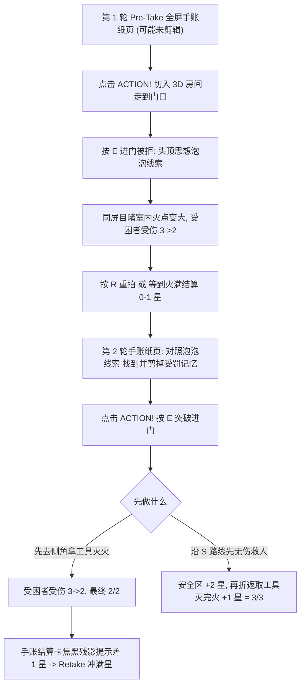

# 08 — LEVEL 01：消防员（Fire Call）关卡详案

> 本文是第一关《消防员（Fire Call）》的**唯一完整关卡详案**，统一收归本关的交付范围、Persona 文字块清单、角色与 NPC 行为契约、空间布局与 S 形动线、交互细则、火势节奏配平、动态星容器与 0–3 星判定、本关数据字段草案、美术资产交付清单、UI 挂点、现有工程偏差表及决策记录。
> - 全局核心玩法与操作契约见 [`01_GDD_CORE.md`](01_GDD_CORE.md)；
> - 2.5D 空间映射与定高定角平移跟随相机与横切剖面规范见 [`02_SPATIAL_MATH.md`](02_SPATIAL_MATH.md)；
> - 状态机与逻辑/表现解耦架构见 [`03_ARCHITECTURE.md`](03_ARCHITECTURE.md)；
> - 通用数据字段契约见 [`04_DATA_SCHEMA.md`](04_DATA_SCHEMA.md)；
> - 灰盒资源接口与通用命名规范见 [`05_ASSET_PIPELINE.md`](05_ASSET_PIPELINE.md)；
> - 角色画风（古早萌系纯色无阴影人类小人）与 2D 纸片技术出图规范见 [`06_ART_DIRECTION.md`](06_ART_DIRECTION.md)；
> - 「古早萌系手账」UI 视觉与交互规范见 [`07_UI_UX_SPEC.md`](07_UI_UX_SPEC.md)。
> - 本文**不写死具体秒数、厘米尺寸与正式英文词句**（见 [`AGENTS.md`](../AGENTS.md) 红线 13）；配平只给**相对关系约束**，具体数值与英文文本留待 UE 编辑器配置与灰盒实测校准。

---

## 1. 关卡概要与交付范围 `[已确认]`

| 项 | 内容 |
|---|---|
| **关卡代号与地图名** | `Fire Call`（地图资产：`L_Firefighter`，兼容现有 `Firefighter`；UI 不展示 `SCENE 01` 场次前缀） |
| **当前交付范围** | **优先集中完成本关单关完整闭环**；后续关卡暂未设定，当前阶段不制作「下一关」流转逻辑，手账结算卡仅提供重开冲星与完成演出闭环 |
| **游戏内文本语言** | 英文（English） |
| **主角** | 消防员（人类小人；**不设血条与死亡判定**，即使火势最终铺满全屋，此前已护送出门的救援星数依然保留） |
| **NPC** | 队长 Captain（全程无台词、门外撑手拦门）；受困者 Civilian（室内深处，三态切换） |
| **核心冲突** | 消防员想进屋救人，但「曾因违抗队长受罚」的创伤记忆让他不敢越过门前阻拦的队长 |
| **核心解法** | `Pre-Take` 全屏 Persona 手账纸页剪掉受罚记忆 → 开拍后心理限制消失，按 `E` 突破进门 → 规划路线先后救人与灭火 |
| **满星路线** | 沿 S 形通道优先无伤救人出门（`+2` 星），再折返侧角取工具灭完室内全部火点（`+1` 星）= **`3 / 3` 满星** |
| **设计意图** | 第一关即教学关：让玩家读懂「现场碰壁读线索 → 按 `R` 回 Persona 纸页剪记忆 → 重开突破进门」的因果闭环，并体验「行动顺序决定星级上限」 |

---

## 2. Persona 文字块清单与线索规则 `[已确认结构 · 文案留空]`

- **密度与容错规则 `[已确认]`**：采用轻度阅读筛选结构——**固定身份/动机块 + 1 个关键受罚创伤可删块 + 1～2 个无害日常经历可删块**。Persona 纸页上不止一个可删块，玩家需读懂门前思想泡泡的线索才能找准对应记忆；多删无害日常块**不做任何惩罚**；首关聚焦跑通核心因果循环，**暂不设置删块丢失正面技能的负面惩罚**。
- **编辑与重置规则 `[已确认]`**：仅限 `Pre-Take` 全屏 Persona 手账纸页中点击删除可删文字块；进入 `Active Take` 切入 3D 房间后隐藏该纸页并锁定编辑；单轮内已删块保留划除痕迹且不可单独恢复，只能通过 `Restart Take`（`R` 键或结算卡 `[R] Retake` 按钮）退回 `Pre-Take` 完整重置（`Active Take` 期间是否允许按 `Tab` 只读查看见 §12 待决定项）。

| 块 ID | 类型 | 可删 (`can_delete`) | 可重排 (`can_reorder`) | 赋予标签 (`granted_tags`) | 文案语义槽位（正式英文词句由编辑器配置） |
|---|---|---|---|---|---|
| `Identity` | 固定 · 身份 | 否 (`false`) | 否 (`false`) | 无 | 我是一名消防员 |
| `Motivation` | 固定 · 动机 | 否 (`false`) | 否 (`false`) | 无 | 我想把受困的人从火场里救出来 |
| `PunishmentMemory` | **关键创伤** | 是 (`true`) | 否 (`false`) | `FearDisobeyCaptain` | 曾违抗队长命令冲进火场，事后被严厉惩罚，从此不敢再违抗他 |
| `Daily_A` | 无害日常 | 是 (`true`) | 否 (`false`) | 无 | 与本关无关的日常小事（古早萌系搞怪/治愈语气） |
| `Daily_B` | 无害日常（可选） | 是 (`true`) | 否 (`false`) | 无 | 同上；是否启用由编辑器配置 |

- **文字块显示顺序 `[建议]`**：将 `PunishmentMemory` 夹在固定块与日常块之间，避免它总是排在最后一个而被玩家「顺手全删」时最先误删。
- **线索粒度 `[已确认]`**：门前受阻思想泡泡必须采用**「表层抗拒想法 + 隐晦指向过去经历的心理线索」**，与 `PunishmentMemory` 语义呼应，但**不直接复述** Persona 原文中的原词原句（`[示例]`：`I must obey my captain's orders... Last time I disobeyed him, it ended badly.` — 仅作风格参考，正式词句由编辑器配置）。
- **删除无害块表现**：删除 `Daily_*` 后角色行为无变化，手账纸页上照样留下粗马克笔划除痕迹（见 [`07_UI_UX_SPEC.md`](07_UI_UX_SPEC.md) §4.2）。

---

## 3. 角色与 NPC 行为契约 `[已确认]`

- **玩家角色（消防员）**：
  - 始终保持消防员身份与可操控权，在 3D 水平地面做四/八方向移动（无跳跃）。
  - 不设血条与死亡判定；即使火势最终蔓延铺满全屋，此前已护送踏入 `Z_Safe` 结算的救援星数依然保留。
- **NPC 1：队长（Captain）**：
  - **全程无台词**（`has_dialogue = false`），站在门外入口 `Z0` 前方，以**双手向两侧水平撑开的阻拦姿态**拦截在通往火场的门口前。
  - 当主角持有 `FearDisobeyCaptain` 标签时，在门前按 `E` 触发自身心理限制导致无法进门，主角头顶弹出英文思想泡泡。
  - 当主角在 `Pre-Take` 剪掉 `PunishmentMemory` 后，**队长记忆与站位不变，依然按原剧本撑手拦在门前**，但主角不再受心理限制阻拦，可通过交互走入室内。
- **NPC 2：受困者（Civilian）**：
  - 位于室内深处后区 `Z3`，遵循预设状态演化：随火势推进在「待援未受伤 → 被火波及受伤 → 倒下遇难」之间切换。
  - 一旦在存活状态被主角按 `E` 接手进入合体护送，**受困者状态立即冻结**，后续火势推进不再令其受伤或身亡。

---

## 4. 空间布局、定高定角跟随镜头与 S 形动线

### 4.1 定高定角平移跟随与娃娃屋横切剖面衔接 `[已确认]`
- 依据 [`02_SPATIAL_MATH.md`](02_SPATIAL_MATH.md) §3（透视层次对齐 [`assets/example/envirments/example_0.png`](../assets/example/envirments/example_0.png)）：`Active Take` 采用**定高、定对地俯角、锁死水平朝向的 3D 室内透视平移跟随相机**——`FOV 55°–65°`，对地轻俯角 `5°–15°` 恒定不变，离地高度 `Z` 恒定不变且位于地板与封闭天花板之间，水平朝向 `Yaw` 锁死不旋转，沿水平面 `X/Y` 平滑平移跟随主角并在场景边缘限位（Clamp）。
- **门外与室内衔接（方案 A：娃娃屋横切剖面）**：门外区域（`Z0` 出生点、拦门队长、`Z_Safe` 门外安全区）与着火室内房间（`Z1 / Z2 / Z3`）朝镜头一侧（前墙）统一敞开，中间隔墙开出门口 `D` 并配窗洞/破损视窗（或靠镜头前半截做低矮剖面避让）。首轮在门外受阻时，跟随画面透过门口/视窗直接看清室内左侧后区 `C` 的受困者三态恶化；突破进门后，相机随主角向右、向深处平移展开中右区火点与右侧角灭火工具 `T`，进出门与护送结算全程一镜到底不切镜头。

### 4.2 区域划分 `[已确认要素]`

| 区域 | 位置 | 内容与作用 |
|---|---|---|
| `Z0` 门外入口区 | 隔墙外左侧前敞开舞台 | 主角出生点；队长双手撑开站在门口 `D` 门外一侧阻拦 |
| `Z_Safe` 门外安全区 | 隔墙外左侧（紧邻门外入口） | 合体护送受困者踏入此区域即自动结算救援 |
| `D` 门口与视窗 | 门外与室内的中间隔墙 | 进门交互点 `D`；隔墙配合窗洞/破损视窗（或前半截低矮剖面避让），保障跟随视线不遮挡 |
| 室内（`Z1 / Z2 / Z3`） | 封闭天花板、前侧敞开的 3D 房间 | 多处阻挡火点 + 低矮灰盒隔断共同围出 **S 形救援通道**；前区右侧角分岔放置灭火工具 |

### 4.3 俯视示意图 `[建议：布局示意，具体尺寸与火点数量以灰盒实测为准]`

```text
                        BACK WALL（深处，远离镜头）
+-------------------+-----------------------------------------------+
|    Z_Safe 安全区   |  (C) 受困者                         (F3)      |  Z3 后区
|                   |   ^                                    <---+  |
|                   |   |                                        |  |
|    Z0 门外入口     |  [F1]========= B2 隔断 ===========   [G2]  |  |  B2 与 F1 共同挡路
|                   |   ^                                        ^  |
|                   | 窗洞/视窗 (门外受阻时直视室内近门侧火势与 C)  |  |  Z2 中区
|   [主角] -> [队长]  |   |           (F2)             ---------->|  |
|                   D 门 [G1]======== B1 隔断 =====================  |
|                   |--->                               [T] 灭火工具 |  Z1 前区 = 工具分岔
+-------------------+-----------------------------------------------+
      FRONT 统一朝镜头敞开（或隔墙靠镜头前半截低矮剖面避让）
      镜头：恒定高度 Z + 恒定俯角 5°–15° + 朝向锁死，随主角沿 X/Y 平移跟随（带边缘 Clamp）
```

- **S 形主路**：`D → G1 → 沿 Z2 向右 → G2 → 沿 Z3 向左 → C`（不灭火也可绕行到达受困者）。
- **捷径**：扑灭 `F1` 后，该处阻挡消除，`G1` 可直通 `C`（火点即局部阻挡，灭火即打通捷径）。
- **工具分岔**：`T` 位于前区右侧角，与救人方向**相反**——去拿工具就是在物理上背离受困者。
- **火点**：图中示意 3 处（`F1` 堵捷径、`F2` 压缩中区通道、`F3` 让后区路线擦着火走）；实际初始数量 `N` 由编辑器配置。

### 4.4 布局硬约束 `[建议]`
1. **门外至深处视线贯通**：主角在门外 `Z0` 受阻时，跟随画面透过门口 `D`、隔墙窗洞/破损视窗或前半截低矮剖面必须能一眼看清左侧后区 `C` 处受困者的位置与三态变化（不被中间隔墙挡死）。
2. **隔断低矮**：室内隔断 `B1 / B2` 与陈设保持低矮（低于纸片角色肩部），在恒定 `5°–15°` 轻俯角下不遮挡人物与道具剪影。
3. **主路不可彻底封死**：未扑灭的火点在**任何火势阶段**都不能把 S 形主路彻底堵死（防止在 `RoomEngulfed` 前出现无法通行的死局）。
4. **工具醒目可读**：侧角灭火工具 `T` 放置于镜头可读性清晰的位置，以纯色纸片区分于环境背景，不藏入死角或阴影。

---

## 5. 场景交互细则全表 `[已确认]`

| # | 交互行为 | 触发条件 | 执行结果与反馈 | 状态 |
|---|---|---|---|---|
| 1 | **进门** | 门前靠近 `D` 浮现 `[E]` 提示，按 `E`；且当前**不携带** `FearDisobeyCaptain` | 开门、走入 3D 室内（非坐标瞬移）；队长保持原位 | `[已确认]` |
| 1' | **进门被心理阻止** | 门前靠近 `D` 按 `E`；且当前**携带** `FearDisobeyCaptain` | 拒绝进门；主角头顶弹出屏幕空间英文**思想泡泡**（表层抗拒想法 + 隐晦指向过去经历线索） | `[已确认]` |
| 2 | **拾取灭火工具** | 走到侧角分岔位 `T` 浮现 `[E]` 提示，按 `E` | 地面工具消失；主角纸片切换为**持握灭火器/水枪状态**（走路循环帧同步切为持工具版） | `[已确认]` |
| 2' | **未持工具试图灭火** | 靠近未灭火点按 `E`，且未持有灭火工具 | 拒绝灭火；主角头顶弹出**英文思想泡泡吐槽**提示需先取工具（与进门受阻同一种反馈语言） | `[已确认]` |
| 3 | **按住 `E` 持续喷射灭火** | 持工具靠近任一未灭火点，按住 `E` | 主角切为喷射姿态，`[E]` 键帽外圈水蓝色环形读条推进（`t_spray` 由编辑器配置）；读满扑灭该处火点：**消除该处视觉与碰撞阻挡**，并**延缓 `RoomEngulfed` 剩余时间**（`Δ_delay` 编辑器可配）；当**全部火点扑灭**（`RemainingFireCount == 0`）时立即点亮 **`+1` 星** | `[已确认]` |
| 3' | **中断喷射** | 灭火读条期间松开 `E` 或移动走出触发范围 | 喷射立刻中断，方便玩家随时放弃灭火先去救人；**该火点已喷的读条进度按火点各自保留**（不清空），回来可继续喷（进度是否随时间或阶段回退见 §12） | `[已确认]` |
| 4 | **开始合体护送** | 靠近存活（未受伤或已受伤）受困者浮现 `[E]` 提示，按 `E` | 主角与受困者切换为**一张「消防员 + 受困者」合体 2D 纸片**（未伤版 / 受伤版）一起移动；**接手瞬间冻结受困者健康状态**，之后火势推进不再令其受伤或身亡（护送期间工具显隐/喷射规则见 §12） | `[已确认]` |
| 5 | **踏入安全区完成救援** | 合体护送纸片走入 `Z_Safe` 门外安全区触发器 | 自动结算救援（无需再按 `E`）：未受伤 **`+2` 星** / 已受伤 **`+1` 星**；触发顶部星容器闪现，随后恢复主角单人纸片 | `[已确认]` |
| 6 | **受困者遇难后** | 尚未开始护送且火势已推进至 `CivilianDead` | 受困者切换为**倒下遇难静态纸片**，立即**隐藏 `[E]` 交互提示且按 `E` 无任何反应** | `[已确认]` |
| 7 | **重开重置（Retake）** | `Active Take` 或结算卡界面任何时刻按 `R` 键，或点击手账结算卡 `[R] Retake` 按钮 | 完整重置整份 Persona、Take 状态、角色位置、工具归位、全部火点与阻挡、受困者状态及星容器，退回 `Pre-Take` 全屏 Persona 手账纸页 | `[已确认]` |

---

## 6. 火势四阶段演化与配平约束

### 6.1 火势四阶段无秒表视觉表现 `[已确认]`

本关**不设左上角抽象明面倒计时**，而是以**多处火点视觉尺寸逐阶扩张 + 受困者状态纸片切换**直观传达局势恶化：

| 阶段 (`fire_stage`) | 触发条件 | 画面表现 | 星容器 (`MaxStarContainers`) |
|---|---|---|---|
| `Active` 初始起火 | 点击 `ACTION!` 开拍进入 `Active Take` | 各火点呈初始尺寸燃烧；受困者为「待援未受伤」纸片 | `3` |
| `CivilianInjured` 波及受伤 | 经过 `T_injure` 且受困者尚未开始护送 | 火点视觉扩张一档；受困者切换为「灰头土脸/受伤」纸片 | **`3 → 2`**（顶部居中闪现，最右空心星烧焦碎裂冒烟消失） |
| `CivilianDead` 波及身亡 | 经过 `T_dead` 且受困者尚未开始护送 | 火点再次扩张；受困者切换为「倒下遇难」纸片并移除 `[E]` 交互 | **`2 → 1`**（顶部居中闪现，最右空心星烧焦碎裂冒烟消失） |
| `RoomEngulfed` 铺满全屋 | 经过 `T_engulf`（每扑灭 1 处火点向后延缓 `Δ_delay`） | 全屋火光覆盖铺满 | 立即强制结束本轮并进入结算（已送入 `Z_Safe` 获得的救援星数保留） |

### 6.2 配平约束不等式 `[建议：调参目标，具体秒数不在文档写死]`

记号（均从进入 `Active Take` 开始计时）：
- `t_door`：出生点 `Z0` → 门口 `D` 并进门。
- `t_S`：门口 `D` → 沿 S 形主路到达深处受困者 `C`。
- `t_out`：合体护送受困者从 `C` → 门外 `Z_Safe`（按护送移速计）。
- `t_tool`：门口 `D` → 侧角拿到工具 `T`。
- `t_spray`：单处火点持续喷射读条时长；`N`：预设火点总数。

| 目标体验 | 相对时间约束 |
|---|---|
| **先救人**能无伤 | `T_injure > t_door + t_S` + 合理操作容错（接手即冻结状态，回程 `t_out` 不计入受伤判定） |
| **先拿工具去灭火**会导致受困者受伤 | `T_injure < t_door + t_tool + t_spray + (从工具位绕往受困者的路程)` |
| **满星路线**来得及灭完所有火 | `T_engulf + N × Δ_delay > t_door + t_S + t_out + (Z_Safe → T 路程) + 灭完 N 处火的路程与喷射总耗时` |
| **首轮受阻时能亲眼目睹恶化** | `T_injure`、`T_dead` 落在玩家门口受阻后的可观察时间窗内（依托娃娃屋横切剖面与受困者靠门侧摆位，主角于门外受阻时的跟随画面内即可透过门口/隔墙视窗清楚看到室内火点扩张与受困者纸片依次受伤、倒下） |

> 所有 `T_*`、`Δ_delay`、`t_spray`、`N` 均必须开放给 UE 编辑器配置；以上不等式用于编程与关卡侧在灰盒实测时校准数值，实现「先救人后灭火 `3/3` 星、先灭火后救人 `2/2` 星」的博弈体验。

---

## 7. 动态星容器规则与 0–3 星结算判定 `[已确认]`

### 7.1 非常驻即时闪现规则
- **非长驻显示**：星容器在 `Active Take` 期间**不常驻**屏幕，仅在**星数点亮（`EarnedStars` 增加）**或**容器上限扣减（`MaxStarContainers` 减少）**发生瞬间，在**屏幕顶部居中即时闪现提示（约 2 秒后淡出）**，平时隐去以保持画面沉浸感。
- **初始上限**：每轮开始默认 `MaxStarContainers = 3`（`☆ ☆ ☆`）、`EarnedStars = 0`。
- **点亮规则（共 3 星来源）**：
  - **扑灭室内全部火点**（`RemainingFireCount == 0`）：立即点亮 **`+1` 颗星**（单处灭完不单独加星，仅消除阻挡与延缓火满）。
  - **救出受困者（已受伤状态）**：合体护送踏入 `Z_Safe` 时，立即点亮 **`+1` 颗星**。
  - **无伤救出受困者（未受伤状态）**：合体护送踏入 `Z_Safe` 时，立即点亮 **`+2` 颗星**（存活 1 星 + 无伤 1 星）。
- **容器实时扣减规则**（仅作用于尚未开始护送的受困者）：
  - `CivilianInjured`：失去无伤可能，`MaxStarContainers` 由 **`3 → 2`**（最右侧空心星焦黑裂开冒烟消失）。
  - `CivilianDead`：失去救活可能，`MaxStarContainers` 由 **`2 → 1`**（最右侧空心星焦黑裂开冒烟消失）。

### 7.2 最终星级判定全表

| 最终客观结果 | 最终获得星数 | 结算时星容器状态（含焦黑碎裂残影） |
|---|---|---|
| 火点未全灭 + 受困者未救出 | **0 星** | `0 / 1`（火满全屋致受困者已遇难） |
| 仅扑灭全部火点（受困者已遇难未救出） | **1 星** | `1 / 1` |
| 仅救出已受伤受困者（火点未全灭，直至火满全屋收工） | **1 星** | `1 / 2` |
| 仅无伤救出受困者（火点未全灭，直至火满全屋收工） | **2 星** | `2 / 3` |
| 扑灭全部火点 + 救出已受伤受困者 | **2 星** | `2 / 2` |
| 扑灭全部火点 + 无伤救出受困者 | **3 星** | `3 / 3`（沿 S 路线先救人出门再折返灭完所有火即可达成） |

### 7.3 单轮演出自动结束条件
满足以下任一条件立即弹出手账结算卡（展示点亮星、剩余容器、失去容器的焦黑残影与客观结果行，提供 `[R] Retake` 按钮，无 `CUT!` 标题口令与下一关按钮）：
1. **达成当前容器满星**：`EarnedStars == MaxStarContainers`（无论 `3/3`、`2/2` 或 `1/1`，把当前仍可挽救的目标全部完成即自然收工）。
2. **火势铺满全屋**：`fire_stage == RoomEngulfed` 强制结束本轮（此前已护送出门所获得的救援星数予以保留）。

---

## 8. 体验节拍（设计预期）



- **第 1 轮教学目标**：让玩家亲眼看到「未删记忆 → 门口受阻 → 室内局势在眼前恶化」。
- **第 2 轮教学目标**：删对对应记忆后顺畅进门，直观建立「剪除角色记忆 = 改变可执行行为」的因果。
- **冲满星目标**：手账结算卡保留的焦黑碎裂残影提示玩家「原本能拿到 3 星」，引导玩家调整动线先救人后灭火。

---

## 9. 本关数据配置契约与编辑器留空清单 `[候选结构]`

以下字段专属于第一关《消防员》，遵循 [`04_DATA_SCHEMA.md`](04_DATA_SCHEMA.md) 通用契约：未知数值与正式英文词句统一保持 `null`，由 UE 编辑器配置与灰盒实测填入。

### 9.1 队长 NPC 剧本配置

```json
{
  "npc_id": "Captain",
  "has_dialogue": false,
  "posture_or_behavior": "BlockEntranceArmsSpread",
  "position_zone": "Z0_DoorExterior"
}
```

### 9.2 消防员关卡场景与状态字段草案

```json
{
  "scene_id": "FireCall",
  "controlled_character_id": "Firefighter",
  "has_extinguish_tool": false,
  "tool_placement_rule": "SideCornerPhysicalBranch_AwayFromMainRescuePath",
  "fire_layout_rule": "MultipleBlockingFires_FormingSCurveCorridor",
  "initial_fire_spot_count": null,
  "remaining_fire_spot_count": null,
  "extinguish_hold_duration_sec_per_spot": null,
  "engulf_delay_bonus_sec_per_spot_extinguished": null,
  "extinguish_progress_on_release": "KeepPerSpot",
  "fire_stage": "Active | CivilianInjured | CivilianDead | RoomEngulfed | AllExtinguished",
  "civilian_state": "Uninjured | Injured | Dead_NonInteractable | EscortingUninjured | EscortingInjured | RescuedUninjured | RescuedInjured",
  "fire_stage_durations_sec": {
    "to_injure_civilian": null,
    "to_kill_civilian": null,
    "to_engulf_room": null
  },
  "max_star_containers": 3,
  "earned_stars": 0,
  "take_end_condition": "EarnedStarsEqualsMaxContainers_Or_RoomEngulfed"
}
```

### 9.3 必须开放给 UE 编辑器配置的留空清单（严禁代码写死）
1. **英文文案**：`Identity` / `Motivation` / `PunishmentMemory` / `Daily_A` / `Daily_B` 的正式英文句子、门前受阻思想泡泡文案、未拿工具试图灭火的吐槽思想泡泡文案、以及页眉标题/开始按钮/交互提示/结算结果行的正式英文文本。
2. **火势与灭火数值**：初始火点数量 `N`（及各火点摆位）、单处按住 `E` 读条秒数 `t_spray`、单处扑灭延缓全屋火满秒数 `Δ_delay`、四阶段阈值秒数（`T_injure` / `T_dead` / `T_engulf`）。
3. **空间与移动校准参数**：主角移速、合体护送移速、碰撞体与 `[E]` 交互触发半径、平移跟随相机的恒定离地高度 `constant_height_z_cm`、恒定锁死偏航角 `locked_yaw_deg`、相对主角水平偏移 `follow_offset_xy_cm`、平滑阻尼 `follow_lag_speed` 与水平边缘限位框 `world_xy_clamp_bounds_cm`（满足 `FOV 55°–65° / 恒定俯角 5°–15°` 及门外直视受困者构图约束）。

---

## 10. 本关美术资产交付清单与 UI 挂点 `[已确认]`

> 所有 2D 纸片必须严格遵守 [`06_ART_DIRECTION.md`](06_ART_DIRECTION.md) §2–§3（多罗猫式古早萌系搞怪反差人类小人、纯色无阴影平涂、平视立绘、100% 硬切实边 RGBA PNG、`Bottom-Center` Pivot、统一画布尺寸与脚底基线、禁画字母数字）及 [`05_ASSET_PIPELINE.md`](05_ASSET_PIPELINE.md) 资产命名前缀规范（`T_ / S_ / FB_ / M_ / MI_ / WBP_ / NS_`）。

### 10.1 角色、NPC 与合体纸片清单

| 对象 | 状态与所需帧数 | 触发条件 / 备注 |
|---|---|---|
| **主角：消防员（单人）** | 待机 `1` 张（或 `2` 帧轻微呼吸）；空手走路 **`2–4` 帧小碎步** | 默认初始态 |
| **主角：消防员（持工具）** | 持工具待机 `1` 张 + 持工具走路 **`2–4` 帧小碎步**（或拆分独立手持工具图层组合） | 在 `T` 点按 `E` 拾取灭火工具后 |
| **主角：消防员（喷射灭火）** | 按住 `E` 持续喷射姿态 `1–2` 张 | 持工具对准火点按住 `E` 读条时 |
| **主角 + 受困者（合体护送纸片）** | **合体未伤版**（待机 `1` 张 + **`2–4` 帧小碎步**）；**合体受伤版**（待机 `1` 张 + **`2–4` 帧小碎步**） | 在 `C` 点按 `E` 开始护送 → 踏入 `Z_Safe` 前；与单人纸片共用画布尺寸、`Bottom-Center` 锚点与脚底基线（搀扶/背起/扛起姿态由美术选定；是否画出工具见 §12） |
| **NPC 1：队长（Captain）** | 门外阻拦姿态 `1–2` 张：**双手向两侧水平撑开死死拦路** | 全程驻守 `Z0` 门前；神态严肃强硬又带古早配角喜感反差，无台词 |
| **NPC 2：受困者（Civilian）** | ① **待援未受伤**（`1–2` 张）；② **被火波及受伤**（灰头土脸/捂伤，`1–2` 张）；③ **倒下遇难**（静态 `1` 张） | 随火势四阶段切换；护送已改为合体纸片，**不再需要受困者单独跟随走路帧** |

### 10.2 场景交互物与火势视觉

| 对象 | 状态与表现 | 触发 / 备注 |
|---|---|---|
| **房门纸片** | 关闭态 / 开启态 | 进门交互开启后保持敞开 |
| **便携灭火工具纸片** | 放置态（灭火器或水枪，醒目纯色） | 放置于 `T` 侧角；按 `E` 拾取后从地面消失 |
| **多处阻挡火点与四阶段火势** | 初始 / 扩张 1 / 扩张 2（若采用 2D 纸片，含 `2–3` 帧跳动循环）；全屋火满覆盖表现 | 扑灭单处后隐藏/清除该处视觉与碰撞阻挡；采用 2D 纸片或 3D `NS_` 特效见 §12 |

### 10.3 本关 UI 挂点（对齐 [`07_UI_UX_SPEC.md`](07_UI_UX_SPEC.md) §8 正式组件名）

| 时机 | UI 组件 (`WBP_*`) | 视觉与交互表现 |
|---|---|---|
| **`Pre-Take` 开拍前** | `WBP_PreTakeScript`、`WBP_PersonaBlock`、`WBP_ActionButton` | 全屏奶油色手账纸页（纯色胶带贴角，隐藏房间，无 `SCENE/TAKE` 编号与 `DIRECTOR'S CUT` 印章）；`Identity` / `Motivation` 呈固定块，`PunishmentMemory` / `Daily_A` / `Daily_B` 呈荧光底虚线可删块（悬停变粉+剪刀光标，点击后粗马克笔划除保留原文）；底部圆角手账按钮 `ACTION!`（无场记板造型与打板动效） |
| **`Active Take` 低打扰重开提示** | `WBP_RetakeHint` | 屏幕右上角低打扰显示小尺寸圆胖 `[R]` 键帽 + `Retake` 文字（无场记牌造型、无黑白斜纹、无 `TAKE` 计数） |
| **靠近可交互目标** | `WBP_InteractPrompt` | 锚定 3D 位置投影显示圆胖 `[E]` 键帽 + 动词标签（进门/拾取/灭火/护送；受困者倒下后隐藏） |
| **持工具按住 `E` 灭火** | `WBP_InteractPrompt`（读条态） | `[E]` 键帽外圈显示水蓝色（`Sky`）环形喷水进度，只映射权威层按火点保留的当前进度 |
| **门前受阻 / 未持工具按 `E` 灭火** | `WBP_ThoughtBubble` | 锚定主角头顶 3D 坐标的屏幕空间圆点尾巴想法气泡（`Paper` 底 + `Peach` 描边） |
| **星数增加或容器扣减** | `WBP_StarPopup` | 屏幕顶部居中即时闪现约 2 秒后淡出：实心奶油黄点亮星，或最右空心星焦黑裂开冒卡通烟消失（`3→2` / `2→1`） |
| **单轮结算** | `WBP_TakeResult` | 大圆角奶油色手账结算卡（无场记板合拍、无小黑板外框、无 `CUT!` 口令与 `TAKE` 计数）；展示最终点亮星、剩余容器、失去容器的焦黑碎裂残影及客观结果行（火点/受困者/星数），按钮 `[R] Retake` 返回 `Pre-Take` |

---

## 11. 现有 `DirectorCutJam/` 工程偏差对照表与本关验收清单

### 11.1 现有早期工程现状与正式约束偏差（供 `编程 Agent` 重构对齐）

| 模块 | 现有早期工程现状 | 已确认正式约束要求 |
|---|---|---|
| **摄像机与房间** | 绑在主角弹簧臂上的 `-58°` 高空俯视无顶矮墙盒子 | `Active Take` 全程采用定高（`Z` 位于地板与封闭天花板之间）、定对地俯角（`5°–15°`）、锁死水平朝向（不继承角色旋转、`Roll = 0°`）的 3D 透视平移跟随相机（`FOV 55°–65°`，水平 `X/Y` 平滑跟随 + 边缘 Clamp）；补齐封闭天花板，门外与室内采用朝镜头一侧敞开的娃娃屋横切剖面衔接，中间隔墙开门口配视窗/前半截低矮剖面避让，门外受阻即可直视室内受困者 |
| **角色与物品表现** | 主角为双 `Sphere`，NPC/火为 `Cube`，交互点为铺地扁平 `Cube` | 主角底层保持单套权威逻辑，表现层提供 `VisualMode`（`2D_Paper` / `3D_Mesh`）切换开关（开发期 2D 纸片未齐时先以 3D 几何白模占位救急验证，并供一键对比视觉效果）；队长、受困者（未伤/受伤/倒下三态）及交互物均改为底边中心接地的竖直 2D 纸片（`Masked` 双面写深度、水平镜像 Flip 转身） |
| **Persona 界面与时机** | 默认允许演出中途随时开关面板编辑（`bAllowEditingDuringTake = true`） | `Pre-Take` 为全屏纯文字纸页（看不见房间）；点击 `ACTION!` 切入房间并隐藏锁定编辑页，按 `R` 键或结算按钮整轮重置退回 `Pre-Take` |
| **队长 NPC 表现** | HUD 顶部播报多句英文命令台词并定时平移方块 | 队长全程无台词，以双手撑开姿态纸片固定拦截在门口前方 |
| **场景空间与交互颗粒度** | 按 `E` 坐标瞬移过门、单火块与受困者方块原地即刻消除 | 靠近浮现 `[E]` 提示；按 `E` 走入室内；多处阻挡火点呈 S 形动线 + 侧角分岔取工具；持工具按住 `E` 读条灭火（松手中断按火点保留进度、单处消除阻挡并延缓全屋火满、全灭得星）；未持工具冒吐槽思想泡泡；按 `E` 切换合体纸片护送踏入安全区自动结算（接手即冻结状态，身亡后移除交互） |
| **节奏与评价 UI** | 常驻左上角 120s 读秒，仅 0–2 星，三星留空 | 取消抽象读秒，改为火点扩张与受困者三态切换的四阶段蔓延；非常驻顶部居中闪现 3 星容器（受伤 `3→2`、身亡 `2→1`），开放 `0–3` 星单关完整闭环 |

### 11.2 本关综合验收清单（编程 Agent 验功能、设计 Agent 验设计与视觉）

- [ ] **Persona 纸页与重开闭环**：`Pre-Take` 为全屏手账纸页且固定块/可删块/已删块三态分明（无场记板/`DIRECTOR'S CUT` 印章/好莱坞剧本格式/`SCENE`&`TAKE` 编号）；纸页至少有 2 个可删块，删 `Daily_*` 无惩罚，删 `PunishmentMemory` 后可进门；`Active Take` 隐藏并锁定编辑（无场记牌，仅右上角低打扰显示纯圆角键帽 `[R] Retake` 提示），按 `R` 键或结算卡 `[R] Retake` 可完整重置回 `Pre-Take`。
- [ ] **空间与视线**：跟随相机在全程移动中保持离地高度、对地轻俯角（`5°–15°`）与水平朝向完全不变，沿水平 `X/Y` 平滑平移并在场景边界准确 Clamp；同时呈现封闭天花板、墙面与地面；门外 `Z0`/`Z_Safe` 与室内通过娃娃屋前敞开横切剖面顺畅衔接，主角于门外受阻时透过门口/视窗可直接看清深处受困者；隔断低矮不遮挡纸片剪影，`Masked` 双面纸片与 3D 墙壁/门框/角色前后遮挡准确，脚底不悬空不后仰。
- [ ] **S 形动线与捷径**：多处火点与隔断构成 S 形通道，任何阶段均不彻底封死主路；灭火工具位于远离主路的侧角 `T`；扑灭 `F1` 后阻挡消除并打通捷径。
- [ ] **交互细节**：未删记忆时门前按 `E` 被拒并弹出含隐晦线索的思想泡泡；未拿工具对火按 `E` 弹出吐槽思想泡泡；持工具按住 `E` 水蓝环形读条灭火，松手/走开中断且按火点保留进度；按 `E` 护送切合体纸片并冻结受困者状态，踏入 `Z_Safe` 自动结算；受困者倒下后隐藏 `[E]` 且按 `E` 无反应。
- [ ] **配平与结算**：按 §6.2 调参后，「先沿 S 路救人后取工具灭火」可拿满 `3/3` 星，「先取工具灭火再救人」致受困者受伤拿 `2/2` 星；非常驻星容器闪现时机与受困者纸片变化同步，手账结算卡焦黑残影准确揭示未达目标。

---

## 12. 决策记录与待决定项

### 12.1 已拍板（2026-11-14 用户确认）

| # | 问题 | 决定 |
|---|---|---|
| 1 | 护送表现 | **合体纸片**：按 `E` 后主角与受困者切换为一张合体纸片移动（合体未伤版 / 合体受伤版）；取消受困者单独跟随走路帧 |
| 2 | 护送途中是否会受伤 | **不会**：一旦按 `E` 开始护送即视为已接手，受困者状态立即冻结 |
| 3 | 中断喷射 | **按火点保留进度**：松手或走开后，该火点已喷读条进度保留（不清空），回来可继续喷 |
| 4 | 未拿工具就去灭火 | **思想泡泡**：主角头顶冒出英文思想泡泡吐槽（与进门受阻统一反馈语言） |
| 5 | UI 去电影片场化 | **删除**场记板造型与合拍动效、`DIRECTOR'S CUT` 印章、好莱坞剧本格式与打字机字体、右上角常驻场记牌、`SCENE/TAKE` 编号及 `CUT!` 口令；**保留**「古早萌系手账」纸页、纯色胶带角、三态涂改交互、圆角 `ACTION!` 按钮与 `[R] Retake`；`Active Take` 右上角采用低打扰纯圆角键帽 `[R] Retake` 提示（`WBP_RetakeHint`，不含场记牌与 `TAKE` 编号） |
| 6 | 镜头跟随与门外室内空间衔接 | **定高定角平移跟随相机 + 娃娃屋横切剖面（方案 A）**：相机离地高度 `Z`（处于地板与封闭天花板之间）、对地俯角（`5°–15°`）与水平朝向 `Yaw` 全程锁死不变，沿水平 `X/Y` 平滑平移跟随主角并做边缘限位（Clamp）；门外（`Z0` / 队长 / `Z_Safe`）与室内前墙统一敞开，中间隔墙开门口并配窗洞/视窗（或前半截低矮剖面避让），首轮门外受阻时跟随画面仍可直接看到近门侧受困者恶化 |
| 7 | 主角 2D/3D 表现层切换开关 | **单套权威逻辑 + VisualMode 表现开关**：底层移动/碰撞/交互/Persona 门控 100% 共用；表现层开放 `VisualMode`（`2D_Paper` 与 `3D_Mesh`）切换开关。开发期 2D 纸片资产未齐时可先以 3D 几何白模占位救急跑通关卡，并随时一键切换对比两种风格在实际场景中的视觉效果 |

### 12.2 仍待决定（不得由 Agent 擅自拍板）

| # | 问题 | 选项 / 说明 | 关联文档 |
|---|---|---|---|
| 1 | 中断喷射后「进度保留但会增长」的具体机制 | 用户原话「读条进度保留但会增长」，需确认是：**A)** 保留的喷射进度会随时间缓慢回退（相当于火势慢慢重新长大）；还是 **B)** 已喷进度保留不变，但火势升阶后该火点变大、所需总喷射量增加 | [`07_UI_UX_SPEC.md`](07_UI_UX_SPEC.md) §5.2 |
| 2 | 合体护送期间的手持工具表现与功能 | **A)** 隐藏工具且护送期间不能喷射（只需 2 套合体纸片）；还是 **B)** 合体纸片同时显示手持工具且允许护送途中使用（需额外「合体+持工具」版本） | [`06_ART_DIRECTION.md`](06_ART_DIRECTION.md) §5 |
| 3 | 火点碰撞阻挡是否随火势扩张而变大 | 若阻挡体积随阶段扩张，必须仍满足 §4.4 第 3 条（S 形主路在任何阶段不被彻底封死） | [`02_SPATIAL_MATH.md`](02_SPATIAL_MATH.md) §6 |
| 4 | `Active Take` 期间是否允许按 `Tab` 只读查看当前 Persona | 默认隐藏 Persona 纸页并锁定编辑；是否提供 `Tab` 键只读回看本轮残留文字块（不可剪辑）待确认 | [`07_UI_UX_SPEC.md`](07_UI_UX_SPEC.md) §5.4 |
| 5 | 初始火点数量 `N` 与 `Daily_B` 是否启用 | 编辑器配置项；本文示意 `N = 3`、`Daily_B` 为可选 | §2、§9.3 |
| 6 | 火焰采用 2D 纯色插画序列帧还是 3D 风格化特效，以及主角消防服配色 | 美术制作细化参数（需与火光拉开识别度） | [`06_ART_DIRECTION.md`](06_ART_DIRECTION.md) §6 |
